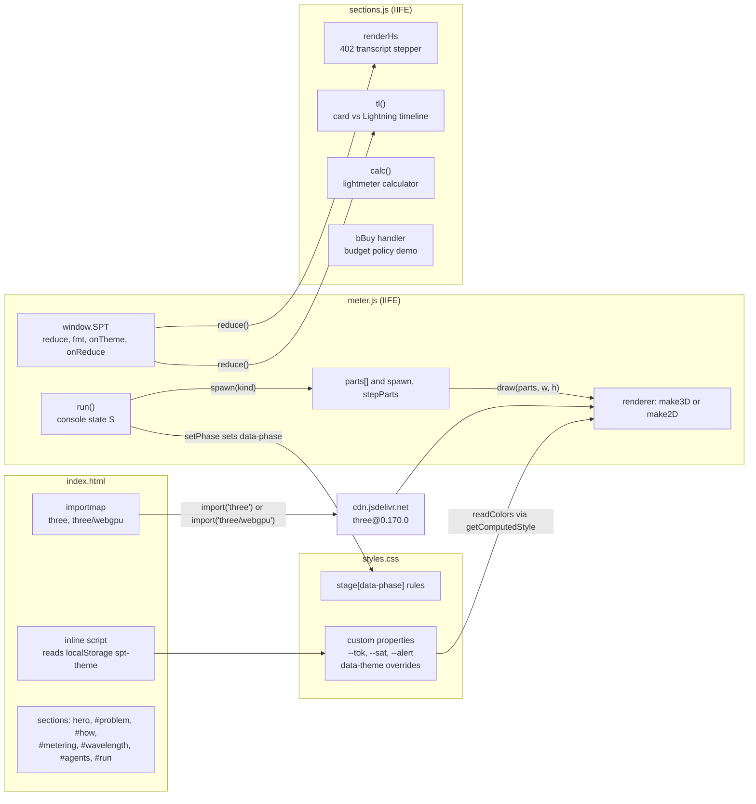
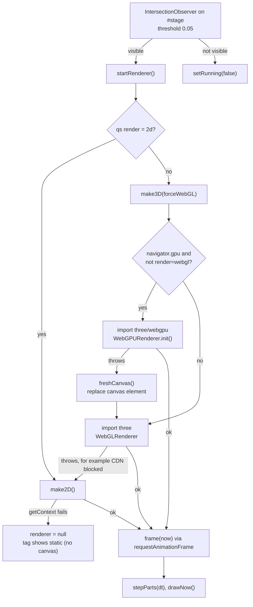
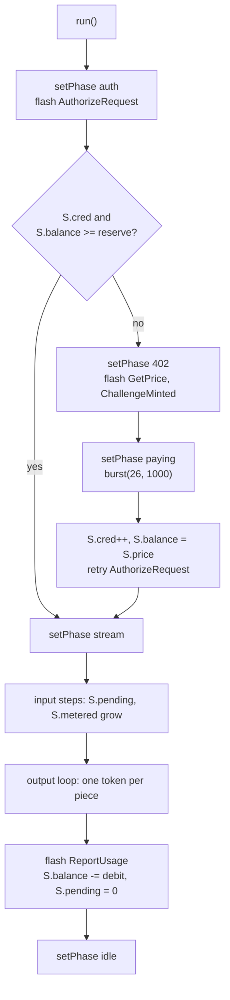

# Sats Per Token site architecture

This document maps how the static launch site is put together: which file owns
what, how the hero meter and the interactive panels are wired, which external
files load from where, and how the site is served and deployed. It describes
the tree at commit `10b65d6`. The site has no build step, no package manifest,
and no tests, so everything below is read directly from `index.html`,
`styles.css`, `meter.js`, and `sections.js`. For the purpose of the site and
the debug query flags, see the [README](../README.md).

One point differs from what a "scroll-driven scene" would suggest: nothing in
the site maps scroll position to the three.js scene. The meter scene is driven
by the operator console state (`S` in `meter.js`), and scroll only decides
whether the render loop runs, through an `IntersectionObserver`. The sections
below the hero are independent of the scene.

## Components

The page is one HTML document that loads two classic scripts in order. There
are no modules except the dynamic `import()` of three.js, so the site runs from
`file://`. `meter.js` runs first and publishes `window.SPT`; `sections.js` runs
second and reads it.



The diagram shows two couplings between the files. `meter.js` talks to the
page through element ids (`stage`, `meterCanvas`, `renderTag`, and the console
inputs), and to the stylesheet through the `data-phase` attribute and the
`--tok` and `--sat` custom properties. `sections.js` depends on `meter.js` only
through `window.SPT.reduce()`; it does not use `window.SPT.fmt` and keeps its
own `fmt`.

| File | Owns | Does not own |
| --- | --- | --- |
| `index.html` | Page copy, element ids that scripts bind to, the `importmap` pinning three.js, the pre-paint theme script, the font links, the `<script>` order | Any behavior beyond the theme bootstrap |
| `styles.css` | Layout, dark and light palettes (`:root[data-theme="light"]` and the `prefers-color-scheme` block), `.stage[data-phase=...]` styling of the gate, banner, and pillars, reduced-motion rules | Particle colors on the canvas (read from the custom properties by `meter.js`) |
| `meter.js` | `window.SPT`, theme toggle (`themeBtn`), the tokenizer, particle list, both renderers, render loop, console state `S`, the `run()` simulation, the protocol log | The sections below the hero |
| `sections.js` | The 402 transcript stepper, the timeline, the pricing calculator, the budget demo, the copy buttons | Any rendering to the canvas, theme state |
| `dax-stripe-fraud.png` | The tweet screenshot in `#fraud-figure`, loaded `lazy` | None |
| `.gitignore` | Excludes `brief/`, `design-a/`, `design-b/`, `design-c/`, `.DS_Store` from the published tree | None |

## Page load and theme

Theme is resolved before first paint by the inline script in the `<head>`: if
`localStorage["spt-theme"]` holds `light` or `dark`, it sets `data-theme` on
`<html>`. Without a stored value, the `prefers-color-scheme: light` media query
in `styles.css` decides. `meter.js` toggles the attribute in the `themeBtn`
click handler, stores the choice (inside `try`, since storage can throw), and
calls every callback registered with `SPT.onTheme`. The only registered
callback invalidates the cached canvas colors, so the next frame re-reads
`--tok` and `--sat`.

## The meter scene

The hero has two halves. The operator console (prompt, rates, `Run
completion`) writes state into `S` and logs protocol steps. The stage (`#stage`
with `#meterCanvas`) draws `parts`, a list of particles. The console never
touches the renderer, and the renderer never reads `S`, except `staticFill()`
which builds the frozen reduced-motion scene from `S`.



The renderer is created lazily, the first time the stage intersects the
viewport, and the loop stops when the stage leaves the viewport or the tab is
hidden (`visibilitychange`). Without `IntersectionObserver`, the renderer starts
immediately and `visible` stays true.

1. **Select the renderer.** `startRenderer()` calls `make3D()` unless
   `?render=2d` is set. `make3D()` tries `three/webgpu` when `navigator.gpu`
   exists and `?render=webgl` is absent, then `three` (`WebGLRenderer`, with
   `powerPreference: "low-power"`). If either import or initialization throws,
   `make2D()` is used. `renderer.name` is written to `#renderTag`, for example
   `three r170 / webgl`.
2. **Recover from a failed WebGPU init.** A canvas that has requested a WebGPU
   context cannot return a WebGL context, so `freshCanvas()` replaces the
   `<canvas>` element before the WebGL attempt, and `canvasEl` is rebound.
3. **Draw instanced quads.** The 3D path uses one `InstancedMesh` of
   `PlaneGeometry(1, 1)` with `MAXP` instances (640). The instance count is
   fixed because `WebGPURenderer` sizes its buffer at the first render, so
   unused instances are set to a zero-scale matrix instead. Per frame,
   `draw()` writes one matrix and one color per particle from `particleXY()`.
4. **Tilt.** `pointermove` on the stage sets a target rotation; `draw()`
   eases `group.rotation` toward it by 0.06 per frame. Pointer tilt is
   skipped when `reduce` is true.

### Console state to scene

There are no shader uniforms: the scene is driven by particles and material
colors, not custom shaders. The mapping from console to scene is:

| Console source (`meter.js`) | Scene effect |
| --- | --- |
| Typing in `#prompt` (`input` handler) | Up to three ghost particles of kind 0 per change (`spawn(0, {ghost: true})`) |
| `run()` prompt phase | Kind 0 particles on the input lane (lane 0.26 of stage height), plus kind 2 sat particles per 14 msat (`SAT_UNIT`) |
| `run()` completion loop | One kind 1 token particle per output piece, moving from the model pillar to the buyer pillar, plus kind 2 sats |
| `run()` payment phase | `burst(26, 1000)`, 26 kind 3 particles over 1000 ms |
| `setPhase(ph, text)` | `data-phase` on `#stage` (`idle`, `auth`, `402`, `paying`, `stream`) and the banner text; `styles.css` recolors the gate, banner, and pillars |
| `flash(name)` | Adds `on` or `act` for 900 ms to elements with `data-rpc=name`: the four price-server pills and the `#rpcTable` rows |
| `hud()` | Readouts, balance bar widths (`barRem`, `barPend`, `barResv`), and the `aria-valuenow` of the bar |

Particle kinds are defined by `LANE` and `spawn()`: 0 is an input token, 1 an
output token, 2 a sat, 3 a payment burst sat. Positions come from
`particleXY()`, which interpolates between `MODEL_X` (0.14) and `BUYER_X`
(0.86) of the stage width.

### The simulated request

`run()` is a single async function guarded by `S.running`. It simulates one
completion against a fake bundle and has two paths, depending on whether a
credential covers the reserve.



The reserve is `min(S.price, inTok * inRate + maxTok * outRate)`, and the
bundle price is `ceil(bundleTok * (inRate + outRate) / 2)` with `bundleTok`
set to 1000 (`readRates()`). The debit is exact usage, `inTok * inRate +
outPieces.length * outRate`. Output text comes from the three canned `SAMPLES`
if the prompt matches one, and otherwise from repeating `FILLER` up to
`min(maxTok, 24 + round(inTok * 0.9))` pieces. Token counting uses the regex
`TOK_RE`, an estimate, not a real tokenizer.

### Reduced motion

`reduce` is true when `prefers-reduced-motion: reduce` matches or `?reduce=1`
is set. In that mode the loop never starts, `spawn` calls are skipped,
`staticFill()` draws a frozen row of particles reflecting the counters, and
`hud()` calls `requestStatic()` to redraw. `SPT.onReduce` re-evaluates the flag
when the media query changes, but a `?reduce=1` flag is kept. `styles.css` has
a matching `@media (prefers-reduced-motion: reduce)` block.

## Interactive sections

All four widgets live in `sections.js`, are unrelated to the canvas, and
re-render by writing into elements found by id. Each is wired once at load and
then called to render its initial state.

| Widget | Elements | State | Behavior |
| --- | --- | --- | --- |
| 402 transcript stepper | `hsSteps`, `hsTx`, `hsNext`, `doorL`, `doorP` | `door` (`L402` or `Payment`), `cur` (0 to 5), `timers` | `model()` returns six step objects; `renderHs()` draws pills, the cumulative transcript up to `cur`, and the annotation. Step 6 streams its lines every 260 ms unless `reduce()`. The door toggle changes the header text in steps 2, 3, and 5. |
| Card vs Lightning timeline | `tlRange` (0 to 120), `tlCB`, `tlPlay`, `tlCard`, `tlLn` | the range value and the checkbox | `tl()` moves every `[data-ph]` playhead to `day / 120` of the bar width and rewrites both captions. The card caption has four branches (day 0, under 60, under 120, 120), and a chargeback at day 90 or later when `tlCB` is checked. The Lightning caption is final from day 0. Play advances 1 day per 60 ms, or 30 days per 600 ms under reduced motion. |
| Pricing calculator | `cModel`, `cMargin`, `cBtc`, `cBundle` | none (pure function of inputs) | `calc()` converts $/Mtok to msat/token as `usd * 1e5 / btcusd`, adds the margin, rounds up with `Math.ceil(round6(x))`, and prices a bundle as `ceil(bundleTokens * (qI + qO) / 2 / 1000)` sats. The `round6` step removes float noise before `ceil`. |
| Budget policy demo | `bFund`, `bReq`, `bDay`, `bModel`, `bBuy` | `B = {spent, n}` | The `bBuy` handler denies in this order: quote above the per-request ceiling, spend plus quote above the daily cap, quote above the remaining wallet. Otherwise it records a payment. |

The copy buttons (`[data-copy]`) read the `innerText` of the sibling `<pre>` and
call `navigator.clipboard.writeText`, falling back to the label `select +
copy`.

Two values are shown on the page as illustrative data and live in `index.html`
(`cModel` and `bModel` option values) rather than in script: the model prices
and the bundle quotes. The `MSAT_USD` constant in `meter.js` (0.00000079) is a
separate hard-coded conversion for the `≈ $` readout and does not follow the
calculator's `btc/usd` input.

## External dependencies

| Dependency | Version | Source | Loaded by | If unavailable |
| --- | --- | --- | --- | --- |
| three.js, `three.module.js` | 0.170.0 | `cdn.jsdelivr.net/npm/three@0.170.0/build/three.module.js` | `importmap` key `three`, via `import("three")` | `make3D` rejects, the Canvas2D renderer is used |
| three.js, `three.webgpu.js` | 0.170.0 | `cdn.jsdelivr.net/npm/three@0.170.0/build/three.webgpu.js` | `importmap` key `three/webgpu`, only when `navigator.gpu` exists | The catch block falls back to WebGL |
| Geist and Geist Mono | `wght@400;500;600` of each | Google Fonts CSS (`fonts.googleapis.com`, `fonts.gstatic.com`) | `<link rel="stylesheet">` | System fallback fonts from `styles.css` |
| Tweet screenshot | n/a | `dax-stripe-fraud.png` in the repository | `` | Alt text shows |

The `label` strings in `make3D` say `three r170` and must be updated by hand if
the pinned version changes. The `importmap` must change in both entries at the
same time, since the WebGPU and WebGL builds have to match.

## Run and deploy

To run locally, open `index.html` directly, or serve the directory so that the
page has an origin:

```bash
python3 -m http.server 8000
```

Both work because the scripts are classic scripts and the only `import()` calls
go to a CDN. A page opened without network access runs with the Canvas2D meter
and system fonts. To exercise a path, add `?render=webgl`, `?render=2d`, or
`?reduce=1` to the URL. The renderer actually chosen is printed in the
`#renderTag` element on the stage and, on a WebGPU failure, in the console as
`[meter] WebGPU init failed`.

Deployment is GitHub Pages, served from the `main` branch at the repository
root, per the README. There is no workflow under `.github/`, no `CNAME` file in
the tree, and nothing to build, so a merge to `main` is the deploy. Editing
copy only touches `index.html`. Adding a custom domain needs a root `CNAME`
file and a DNS record, as the README describes.

## Known gaps

- The Pages configuration (branch, custom domain) is set in the repository
  settings, which this document could not read. The README is the source for
  the deployment description.
- Rendering behavior (the WebGPU path in particular) was not run in a browser
  for this document. The fallback order is read from `make3D()` and
  `startRenderer()`.
- `styles.css` is described only where scripts depend on it; its layout rules
  are not mapped.
- The `#wavelength` diagram is inline SVG in `index.html` and has no script.
